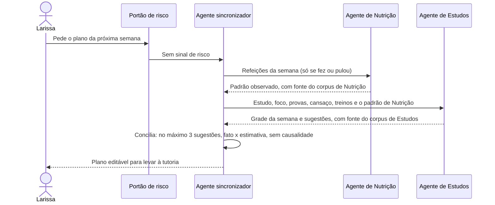

# Agente de Estudos

!!! warning "Rascunho em construção"
    Página em definição pela equipe (iniciada em 17/11/2026). As seções trazem **propostas** de 17/11, ainda a confirmar com o grupo; as decisões em aberto estão na seção 11. Classificação das afirmações, como em todo o projeto: **requisito documentado** (está nos requisitos ou nas regras de negócio, com aprovação ainda não confirmada), **decisão da equipe** (com data), **proposta** (sugestão ainda não decidida) e **hipótese** (benefício a testar).

Os requisitos ficam na lista única do projeto ([Requisitos](../requisitos/index.md) e [Regras de Negócio](../regras-de-negocio.md)). Esta página não cria requisitos: só aponta para eles e registra as decisões de escopo do agente. Uma regra nova necessária para Estudos entra na lista única, com número próprio.

## 1. Definições

| | |
|---|---|
| **Objetivo** | Apoiar a organização dos estudos de jovens adultos e estudantes, dentro da rotina integrada do CULTIVA: planejar a semana e explicar técnicas de estudo com fonte (seção 3). |
| **ODS** | 4 (Educação de Qualidade), pela aba Estudos ([Visão geral](../projeto/index.md)) |
| **Limite** | Como todo o CULTIVA, apoio educativo e organizacional, sem diagnóstico nem substituição de profissionais. Não faz o trabalho acadêmico pelo aluno, não ensina o conteúdo das matérias e não indica remédio (seção 4). |

**Requisitos documentados que se aplicam:**

- **RF-IA06:** agente por área, que responde só na sua área, redireciona perguntas de outras e gera planos editáveis.
- **RF-A05 e RF-A07:** metas por aba e registro manual de hábitos de estudo.
- **RN06:** o Agente de Estudos acessa o cansaço registrado em Saúde para ajustar o planejamento.
- **RN17:** toda informação técnica de estudos traz fonte clicável.
- **RF-IA07 e RF-IA08:** no máximo 3 sugestões por resumo; padrões descritos como associação, sem afirmar causalidade.
- **RF-IA10:** tom acolhedor e não culpabilizador.
- **RF-IA03:** o portão de risco vale em todas as abas, inclusive Estudos.

## 2. Persona e anti-persona

**Persona principal: Larissa, 20 anos** ([Personas](../projeto/personas.md)). 3º semestre de Engenharia, mora em república, faz estágio de meio período e dorme pouco em época de prova. Quer organizar os estudos e manter a rotina até o fim do semestre. Abas principais: Estudos e Nutrição. O CULTIVA ajuda mostrando padrões (alimentação irregular e sessões de estudo menos produtivas) e preparando um plano de estudos simples para levar à tutoria.

**Anti-persona: Bruno, 22 anos** (proposta de 17/11/2026, a confirmar com a equipe).

| | |
|---|---|
| **Comportamento** | Pede ao app para escrever o TCC e resolver as listas de exercício. Na semana de provas, pede o nome e a dose de um remédio para "virar a noite estudando". |
| **Por que importa** | Define as duas recusas do agente: não fazer o trabalho acadêmico pelo aluno e não indicar remédio nem diagnosticar (seção 4). |
| **Resposta esperada** | Recusar sem julgamento e explicar o motivo. No trabalho, oferecer ajuda para planejar como fazer (etapas e prazos). No remédio, encaminhar a médico ou psicólogo. |

## 3. O que o agente faz

**Proposta de 17/11/2026 (MatheusSales2773), a confirmar com a equipe.**

O agente tem dois papéis:

1. **Organizar a rotina de estudos.** Planeja a semana (sessões, pausas, prazos de prova), considerando o que o usuário registrou de estudo e, com consentimento, o cansaço e a alimentação das outras abas (RN06). O plano é uma sugestão editável (RF-IA06).
2. **Explicar técnicas de estudo, com fonte.** Por exemplo, revisão espaçada, autoavaliação (testar-se em vez de só reler), intercalar conteúdos e técnicas de foco e pausa. Toda explicação traz fonte clicável (RN17, RF-IA01); sem fonte aprovada, a resposta é "não sei".

Inclui **procrastinação e gestão do tempo**, com estratégias organizacionais (quebrar tarefas, metas pequenas e progressivas, blocos de tempo), sempre sem tom de culpa (RF-IA10). Quando a procrastinação vem com sofrimento intenso, o agente não faz terapia: encaminha (seção 4).

**Fora do escopo:** ensinar o conteúdo das disciplinas (cálculo, anatomia etc.). O agente ajuda a organizar o estudo da matéria, não explica a matéria.

**Tarefas que a entrega de 20/11 vai demonstrar:**

| Tarefa | Exemplo | Requisitos |
|---|---|---|
| **Plano da semana** | A partir de uma semana de registros (sintéticos) da Larissa, com estudo, sono e cansaço e alimentação, propõe um plano simples para a semana seguinte, com até 3 sugestões, para ela levar à tutoria | RF-IA06, RF-IA07, RF-IA08, RN06 |
| **Dúvida no chat** | "Como revisar para a prova de cálculo em 5 dias?" Responde com técnicas de estudo e fonte, sem ensinar cálculo | RF-IA01, RN17 |

**Hipótese a testar:** planos simples, ligados à rotina real (cansaço, alimentação), ajudam a manter o estudo melhor que um planejador isolado. A existência da tarefa não demonstra esse benefício.

## 4. O que o agente não faz

**Proposta de 17/11/2026 (MatheusSales2773), a confirmar com a equipe.**

| Pedido | Resposta do agente | Base |
|---|---|---|
| **Fazer o trabalho ou a prova pelo aluno** ("escreve minha redação", "resolve essa lista") | Recusa sem julgamento, explica o motivo e oferece ajuda para **organizar** como fazer: dividir em etapas, prazos, blocos de estudo | **Regra nova necessária** (integridade acadêmica): não há regra equivalente na lista única. Proposta: incluir uma RN própria em [Regras de Negócio](../regras-de-negocio.md) |
| **Diagnóstico** ("acho que tenho TDAH", dislexia, ansiedade) | Não diagnostica. Explica por quê e sugere procurar psicólogo ou médico | RN01 (proíbe diagnóstico de saúde física ou mental), RF-IA02 |
| **Remédio para estudar** ("qual remédio tomar para focar?", dose de estimulante) | Nunca indica remédio nem dose. Explica por quê e sugere procurar médico | RF-IA02 (recusa prescrição de medicamentos); passa pelo guardrail de prescrição |
| **Ensinar o conteúdo da matéria** | Não explica a matéria; ajuda a organizar o estudo dela | Escopo (seção 3) |
| **Sinal de risco** (sofrimento intenso, ideação suicida, autolesão) | O portão de risco interrompe o fluxo com a mensagem fixa de acolhimento e o CVV 188, antes de o agente responder | RF-IA03 |

**Encaminhamento:** quando o caso passa do que o agente pode fazer, ele sugere **psicólogo ou médico**. Sinais de risco seguem para o CVV pelo portão de risco, como em todas as abas.

## 5. Entradas

**Proposta de 17/11/2026 (MatheusSales2773), a confirmar com a equipe.**

**Registro na aba Estudos** (RF-A07), pensado para caber em 30 segundos (RNF01):

| Campo | Exemplo | Para que serve |
|---|---|---|
| **Tempo e matéria** | 50 min de Cálculo I | Base do plano e dos padrões |
| **Foco ou rendimento** | 3 de 5 | Padrões como "semanas sem almoço, foco menor" (RF-IA08) |
| **Provas e prazos** | Prova de Cálculo I em 25/11; entrega de relatório em 28/11 | O plano prioriza o que vence primeiro |

**O que o agente vê das outras abas** (RN06), só com consentimento do usuário (RF-A16) e só o necessário, pelo projetor de contexto da [arquitetura](../arquitetura.md):

| Dado | De qual aba | Para que serve | O que **não** vê |
|---|---|---|---|
| **Cansaço e sono** | Saúde | Não marcar sessão longa em dia de cansaço | Outros dados de saúde |
| **Se fez as refeições** | Nutrição | Padrão da Premissa 1 ("nas semanas em que você pulou o almoço, suas sessões de estudo foram mais curtas") | O que a pessoa comeu |
| **Horários de treino** | Saúde Física | Não marcar estudo em cima do treino | Tipo e carga do treino |

**Demonstração de 20/11:** uma semana fictícia da Larissa com esses campos, marcada como **dado sintético** e guardada fora do corpus científico, como pede a separação entre corpus e dados pessoais.

## 6. Saídas

**Proposta de 17/11/2026 (MatheusSales2773), a confirmar com a equipe.**

**Plano da semana:**

- **Grade por dia:** matéria, duração e pausa, priorizando as provas e entregas mais próximas e evitando os dias e horários de cansaço ou treino.
- **Até 3 sugestões** explicadas (RF-IA07), cada uma podendo ser aceita, ajustada ou ignorada.
- **Editável** pelo usuário (RF-IA06).
- **Fato x estimativa** (RF-IA05): cada informação marcada como "Registrado por você" (ex.: "você estudou 3 h de Cálculo") ou "Estimativa da IA" (ex.: "o foco pode estar associado aos dias sem almoço").
- **Linguagem de associação**, nunca de causa (RF-IA08), e tom sem culpa (RF-IA10).
- **Pronto para levar à tutoria**, como na persona; o relatório em PDF é o RF-A15.

**Dúvida no chat:** resposta curta com a técnica de estudo, um exemplo de como aplicar e a fonte clicável (RN17). Sem fonte aprovada, "não sei" (RF-IA01).

## 7. Fontes

**Proposta de 17/11/2026 (MatheusSales2773), a confirmar com a equipe. Responsável pelo corpus de Estudos: MatheusSales2773.**

- **Mesmo processo do corpus de Nutrição:** fonte catalogada no manifesto, com origem verificável, licença conferida no próprio documento, conversão rastreável, revisão e `approval_status`. Só fonte aprovada responde (RN16, RF-IA01).
- **Português e inglês**, como decidido para Nutrição; a resposta ao usuário continua em português (RNF23).
- **Começo pequeno:** 2 a 4 fontes abertas sobre técnicas de estudo, gestão do tempo e procrastinação.

**Candidatas** (a conferir; nenhuma está aprovada):

| Fonte | Tema | Situação |
|---|---|---|
| Weinstein, Madan e Sumeracki (2018), "Teaching the science of learning", *Cognitive Research: Principles and Implications* | As seis técnicas com mais evidência: revisão espaçada, autoteste, intercalar, elaborar, exemplos concretos e combinar palavra e imagem | Acesso aberto (CC BY 4.0 informado pela revista); licença a conferir no PDF |
| Alves, Soares e Jardim (2024) | Autoeficácia, gestão do tempo e procrastinação em 800 universitários brasileiros (citado no [Problema](../projeto/problema.md)) | Localizar, conferir acesso e licença |
| Artigos do SciELO sobre estratégias de aprendizagem e autorregulação no ensino superior | Evidência em português, com público brasileiro | Buscar |

*Pendente:* critérios de busca e seleção para Estudos. O protocolo da issue #47 foi escrito para Nutrição.

## 8. Colaboração com os outros agentes

**Proposta de 17/11/2026 (MatheusSales2773), a confirmar com a equipe.** Segue a [arquitetura proposta](../arquitetura.md): no **chat**, cada agente responde só na sua área e redireciona as outras (RF-IA06); a **integração entre áreas** acontece no **agente sincronizador**, nos resumos e planos (RF-IA09), e cada agente recebe só o contexto necessário.

**Tarefa "plano da semana" (demonstração de 20/11):**

| Agente | Recebe | Entrega |
|---|---|---|
| **Portão de risco** (já existe) | A mensagem | Interrompe com acolhimento e CVV 188, se houver risco (RF-IA03) |
| **Agente de Nutrição** (já existe) | Só se as refeições foram feitas ou puladas | Padrão observado na semana, com fonte |
| **Agente de Estudos** (novo) | Registros de estudo, cansaço e sono, horários de treino e o padrão de Nutrição | Grade da semana e sugestões, com fonte |
| **Agente sincronizador** (novo) | As saídas dos dois agentes | Plano final com até 3 sugestões (RF-IA07), fato x estimativa (RF-IA05), sem afirmar causalidade (RF-IA08) |

**Dúvida no chat da aba Estudos:** portão de risco → Agente de Estudos (busca no corpus de Estudos e responde com fonte, ou "não sei"). Pergunta de outra área recebe a sugestão da aba certa.

*Pendente:* framework de orquestração (Python puro ou LangGraph) e ADR com a decisão.

## 9. Riscos

**Proposta de 17/11/2026 (MatheusSales2773), a confirmar com a equipe.** Complementa os [Riscos](../riscos.md) do projeto.

| Risco | Impacto | Mitigação |
|---|---|---|
| **Pressão e culpa com o plano:** plano apertado ou cobrança por não cumprir gera culpa e ansiedade, sobretudo em época de prova | Médio | Metas pequenas e progressivas, plano editável, tom sem culpa (RF-IA10), lembretes desativáveis (RF-A14) |
| **Ajudar a "colar":** o usuário contorna a recusa e o agente faz o trabalho acadêmico | Médio | Regra de integridade acadêmica e casos adversariais na avaliação |
| **Padrão falso entre áreas:** afirmar que pular o almoço "causa" foco menor com poucos dados | Alto | Só associação, volume mínimo de dados e grau de certeza (RF-IA08) |
| **Privacidade entre abas:** o agente vê mais do que precisa das outras abas | Alto | Projetor de contexto, consentimento por dado (RF-A16) e logs que mostram o que cada agente recebeu (RF-IA09) |

## 10. Avaliação

**Proposta de 17/11/2026 (MatheusSales2773), a confirmar com a equipe.**

**Conjunto inicial para 20/11 (cerca de 15 casos):**

| Tipo | Casos | O que se confere |
|---|---:|---|
| Dúvida de técnica de estudo | 6 | Resposta com fonte aprovada, ou "não sei" sem fonte (RF-IA01, RN17) |
| Plano da semana | 3 | Até 3 sugestões, fato x estimativa, sem causalidade, respeita cansaço, treino e provas |
| Recusa | 3 | Trabalho acadêmico, diagnóstico e remédio recusados, com explicação e encaminhamento |
| Fora da área | 3 | Pergunta de Nutrição ou Saúde Física recebe a sugestão da aba certa (RF-IA06) |

**Depois:** chegar aos 30 casos do RNF28, com casos escritos por quem não escreveu o agente, como no detector de risco.

## 11. Perguntas em aberto

| Pergunta | Por que importa |
|---|---|
| **Para onde encaminhar dúvidas de conteúdo?** O agente não ensina a matéria, mas o encaminhamento definido é só psicólogo ou médico. A persona Larissa leva o plano "à tutoria" | Sem destino, a resposta a "não entendi derivada" fica sem saída. Opções: professor, tutoria da universidade ou monitoria |
| **Regra de integridade acadêmica** precisa entrar na lista única de regras de negócio, com número próprio | Sem ela, a recusa não tem base documental |
| **Framework de orquestração** (Python puro ou LangGraph), com ADR | Define como o sincronizador e os agentes trocam mensagens |
| **Critérios de busca e seleção de fontes de Estudos** | O protocolo da #47 cobre só Nutrição |
| **Validação das propostas desta página pela equipe** | Todas as seções estão como proposta de 17/11 |
| **Profissionais de Estudos na vitrine** (RN09): professores e mentores não têm conselho de classe, mas a validação pede registro (RN14, RN15) | Sem critério, não há como validar esse cadastro |
