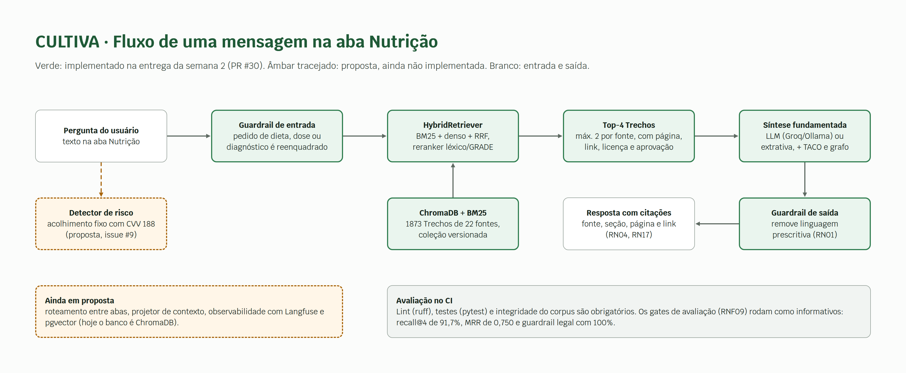
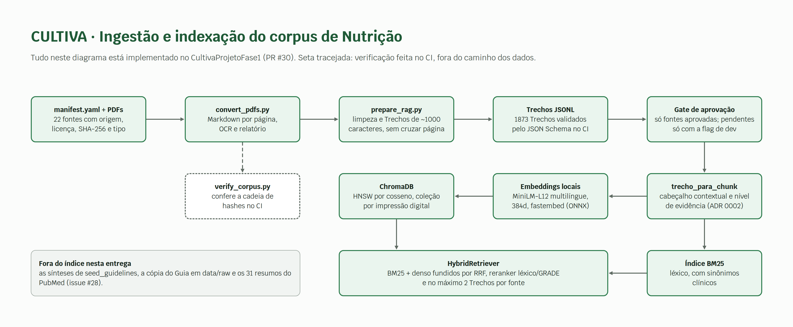
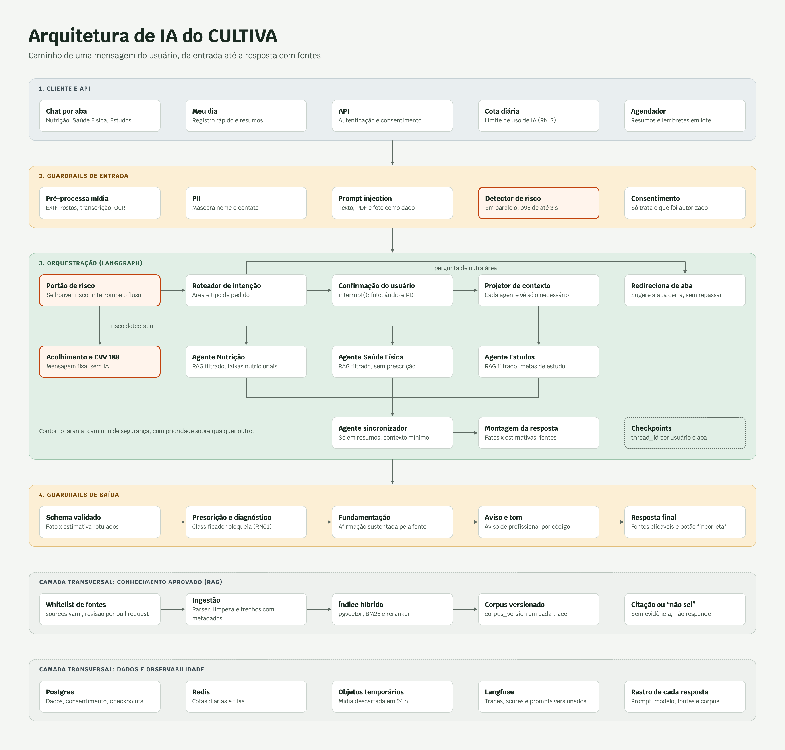
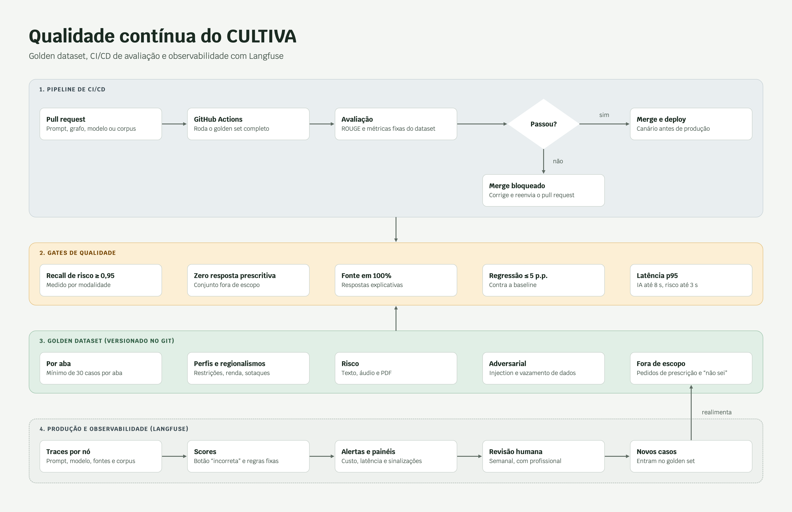

# Arquitetura de IA

!!! warning "Versão provisória"
    Esta arquitetura é uma **proposta inicial**, ainda não validada pela equipe. Ela reúne as decisões discutidas até agora (RAG, multiagentes, multimodal, guardrails, LLMOps e observabilidade) e deve mudar conforme os testes, o golden set e as escolhas de plataforma e provedor. Itens marcados como "a definir" nas [Pendências](pendencias.md) continuam em aberto.

## O que já está implementado (Nutrição, semana 2)

A entrega da semana 2 ([PR #30](https://github.com/Cultiva-Challenge-2-Residencia-IA/CultivaProjetoFase1/pull/30)) implementou o RAG da aba Nutrição no repositório [CultivaProjetoFase1](https://github.com/Cultiva-Challenge-2-Residencia-IA/CultivaProjetoFase1). Os diagramas desta seção separam o que existe em código (verde) do que segue como proposta (âmbar tracejado). O resumo da entrega está em [Entregas > Semana 2](entregas/semana-2.md).

### Fluxo de uma mensagem na aba Nutrição

{ target=_blank }

[Abrir a imagem em tamanho original](assets/arquitetura/arquitetura-fluxo-v2.png){ target=_blank }

### Ingestão e indexação do corpus

{ target=_blank }

[Abrir a imagem em tamanho original](assets/arquitetura/ingestao-corpus.png){ target=_blank }

### Componentes implementados

| Componente | O que faz | Onde está |
|---|---|---|
| Catálogo de fontes | 22 documentos-fonte em PDF com origem, licença, versão, SHA-256, tipo (`source_type`) e `approval_status`. Substitui o `sources.yaml` previsto. | `corpus/manifest.yaml` |
| Conversão | PDF para Markdown com marcador por página física, OCR em páginas sem texto e relatório de cobertura. | `corpus/scripts/convert_pdfs.py` |
| Verificação | Recalcula a cadeia de hashes (PDF, Markdown, script, configuração) e falha se algo mudou sem regeneração. Roda no CI. | `corpus/scripts/verify_corpus.py` |
| Chunking | Limpeza e divisão em Trechos de cerca de 1.000 caracteres (máximo 1.400), sem atravessar página nem seção. Resultado: 1873 Trechos em JSONL, 1818 deles de fontes aprovadas, validados por JSON Schema no CI. | `corpus/scripts/prepare_rag.py` |
| Contrato corpus e retriever | `trecho_para_chunk` converte o Trecho, adiciona um cabeçalho contextual e deriva o nível de evidência do tipo da fonte (heurística a calibrar). | ADR 0002, `src/rag/contrato.py` |
| Gate de aprovação | Por padrão só fontes `aprovado` entram no índice. Hoje são 21 de 22 fontes. Pendentes só entram com `CULTIVA_INCLUIR_PENDENTES=true`. | `src/rag/corpus_loader.py` |
| Embeddings | `paraphrase-multilingual-MiniLM-L12-v2`, 384 dimensões, rodando localmente com `fastembed` (ONNX). Nenhum texto sai da máquina (RNF05). | `src/retrieval/vector_store.py` |
| Banco vetorial | ChromaDB persistente com HNSW por cosseno. O nome da coleção leva a impressão digital do modelo e dos Trechos, então mudar o corpus cria uma coleção nova. | `src/retrieval/vector_store.py` |
| Recuperação híbrida | BM25 com sinônimos clínicos e busca densa, fundidos por Reciprocal Rank Fusion, seguidos de reranker (sobreposição de termos e nível de evidência) e de no máximo 2 Trechos por fonte. Devolve os 4 melhores. | `src/retrieval/hybrid_retriever.py` |
| Guardrails | Entrada: pedidos de dieta, dose ou diagnóstico são reenquadrados para evidência populacional (Lei 8.234/1991, RN01). Saída: remove linguagem prescritiva. | `src/agent/guardrails.py` |
| Citações | Cada resposta traz fonte, seção, página do PDF, link, licença e status de aprovação (RN04, RN17). | `src/demo_entrega.py` |
| CI | Lint (ruff), testes (pytest) e integridade do corpus bloqueiam o merge. Os gates de avaliação (RNF09) comparam o benchmark com o baseline do `main` e, por ora, são informativos. | `.github/workflows/ci.yml`, `eval/gates.toml` |

Benchmark offline, sem LLM, nas 16 perguntas atuais: recall@4 por fonte de 91,7%, MRR de 0,750, cobertura de termos de 88,1% e guardrail legal com 100%. O conjunto é pequeno (só 3 armadilhas de prescrição) e não serve para afirmar robustez.

### Diferenças em relação à proposta

- O banco vetorial é **ChromaDB**, não pgvector. A escolha final segue em aberto.
- O **detector de risco** com acolhimento fixo (CVV 188) **ainda não existe** (issue #9). Por isso o fluxo implementado não cumpre o RF-IA03 nem o RNF29.
- Roteamento entre abas, projetor de contexto, agente sincronizador e Langfuse seguem como proposta.
- A síntese usa LLM (Groq ou Ollama) quando configurado. Sem chave, a resposta é extrativa e determinística, sempre a partir dos mesmos Trechos.

## Proposta completa (provisória)

### Fluxo de uma mensagem

O diagrama mostra o caminho de uma mensagem do usuário, da entrada até a resposta com fontes, e as camadas transversais de conhecimento (RAG), dados e observabilidade.

{ target=_blank }

[Abrir a imagem em tamanho original](assets/arquitetura/arquitetura-fluxo.png){ target=_blank }

#### Principais decisões desta proposta

- **Chat por aba, grafo único.** O usuário conversa dentro de Nutrição, Saúde Física ou Estudos. Uma pergunta de outra área recebe uma mensagem padrão que sugere a aba certa, sem repassar o conteúdo a outro agente (RF-IA06).
- **Risco antes de tudo.** O detector de risco roda em paralelo ao pré-processamento e tem prioridade sobre qualquer outro fluxo. O acolhimento com CVV 188 é uma mensagem fixa, não gerada por IA (RF-IA03, RNF29).
- **Confirmação obrigatória.** Foto, áudio e PDF viram uma proposta de registro e só entram no histórico após confirmação do usuário (RF-A10).
- **Contexto mínimo entre agentes.** Um projetor de contexto entrega a cada agente apenas o que ele precisa. O agente sincronizador só atua nos resumos (RF-IA09).
- **RAG fechado.** Respostas técnicas vêm só de fontes da whitelist, com citação por trecho. Sem evidência, a resposta é "não sei" (RN16, RN17, RF-IA01).
- **Guardrails de saída.** Schema com fato x estimativa, bloqueio de prescrição e diagnóstico, checagem de fundamentação e aviso de profissional inserido por código (RN01, RN02, RF-IA05).
- **Rastreabilidade.** Cada resposta registra versão do prompt, do modelo, das fontes e do corpus (RNF08).

### Qualidade contínua (LLMOps)

O segundo diagrama descreve o ciclo de avaliação: pull request, execução do golden set no CI, gates de qualidade e realimentação com casos vindos da produção.

{ target=_blank }

[Abrir a imagem em tamanho original](assets/arquitetura/qualidade-llmops.png){ target=_blank }

#### Principais decisões desta proposta

- **Avaliação determinística.** A comparação com o golden set usa métricas fixas (como ROUGE e checagens de regra), sem juiz LLM.
- **Gates no CI.** O merge é bloqueado se o recall de risco ficar abaixo de 0,95, se houver resposta prescritiva, se faltar fonte nas respostas explicativas, se houver regressão acima de 5 p.p. ou se a latência sair do p95 (RNF06, RNF09, RNF29).
- **Golden dataset versionado no Git.** Cobre as abas (mínimo de 30 casos por aba), perfis e regionalismos, risco por modalidade, casos adversariais e pedidos fora de escopo (RNF28).
- **Observabilidade com Langfuse.** Traces por nó, scores, alertas e revisão humana semanal. Casos revisados voltam ao golden set.

!!! note "Limitações conhecidas"
    - ROUGE mede sobreposição de palavras com uma resposta de referência. Ele não detecta, sozinho, afirmação sem sustentação na fonte nem prescrição disfarçada. Esses pontos dependem das checagens de regra descritas nos gates.
    - Na produção não há resposta de referência, então ali valem regras fixas e a revisão humana.
    - A avaliação de tom (RF-IA10) segue dependendo de rubrica com revisores.

## Pendências desta arquitetura

- Escolha do provedor de modelo, respeitando o RNF05 (sem uso dos dados para treino). Os embeddings já rodam localmente (MiniLM-L12 multilíngue), mas falta comparar ao menos dois modelos em português no golden set (issue #15).
- Fontes: o esquema foi resolvido pelo `corpus/manifest.yaml` (não haverá `sources.yaml`). Seguem em aberto os critérios de confiabilidade, a decisão sobre a SBAN, única fonte pendente (issue #8) e a rotina de reindexação.
- Banco vetorial definitivo: ChromaDB na implementação atual, pgvector na proposta.
- Calibração do reranker: o MRR caiu de 0,9688 (baseline antigo, 47 fontes) para 0,750 com o corpus curado, porque o bônus por sobreposição de termos rebaixa a fonte certa. O mesmo bônus favorece Trechos em português, o que atrasa a inclusão dos resumos do PubMed (issue #28).
- Grafo de conhecimento e análise causal: incluídos na fase de Nutrição, a partir do baseline `rag-hibrido` (14 cadeias alimento, composto, mecanismo e desfecho). Cada cadeia precisa de fonte citável da whitelist (RN16). A síntese implementada já consulta o grafo e a Tabela TACO, e a decisão para as demais abas segue em aberto.
- Valores de limite diário de interações (RN13) e de custo por usuário (RNF07).
- Plataformas-alvo (RNF24) e canal dos lembretes.
