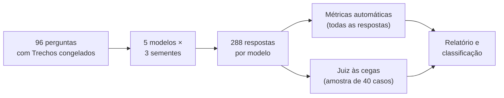

# Escolha do modelo local

Comparação dos modelos do Ollama que podem fazer a síntese do consultor de Nutrição ([issue #55](https://github.com/Cultiva-Challenge-2-Residencia-IA/CultivaProjetoFase1/issues/55)). O código, os dados e o relatório completo estão no [PR #70](https://github.com/Cultiva-Challenge-2-Residencia-IA/CultivaProjetoFase1/pull/70), em `eval/modelo_local/`. Números de 19/11/2026.

!!! warning "Proposta técnica"
    Esta página registra as medições de 19/11/2026. A decisão foi aplicada no [PR #80](https://github.com/Cultiva-Challenge-2-Residencia-IA/CultivaProjetoFase1/pull/80) e registrada no [ADR 0004](https://github.com/Cultiva-Challenge-2-Residencia-IA/CultivaProjetoFase1/blob/main/docs/adrs/0004-modelo-local-ollama.md), ainda sem aprovação formal da equipe. A comparação usou o prompt anterior à issue #12; a conferência com o prompt atual está em [Conferência com o prompt atual](#conferencia-com-o-prompt-atual).

## Resultado

**Principal: `gemma4:e4b`. Reserva: `qwen2.5:7b`** (definida depois da [conferência com o prompt atual](#conferencia-com-o-prompt-atual)).

| Posição | Modelo | Fidelidade | Cobertura de termos | Tempo típico (p50) |
|---|---|---:|---:|---:|
| 1º (principal) | `gemma4:e4b` | **94,1%** | 81,4% | **3,2 s** |
| 2º | `qwen3.5:9b` | 71,2% | 82,0% | 7,9 s |
| 3º | `qwen2.5:7b` (referência; reserva) | 71,0% | 77,1% | 6,0 s |
| 4º | `llama3.1:8b` | 69,1% | 76,4% | 5,2 s |
| 5º | `mistral-nemo:12b` | 67,9% | 75,4% | 22,2 s |

- **O gemma inventa bem menos.** Das afirmações dele, 94% estão apoiadas nos Trechos recuperados. Nos outros modelos, de 29 a 32 em cada 100 não têm base nos Trechos. É o único modelo significativamente melhor que a referência, o `qwen2.5:7b`, que o consultor usava quando a comparação foi feita: +22,6 pontos percentuais, com intervalo de confiança de 95% entre +17,6 e +27,7.
- **Na cobertura, os cinco empatam.** Todos mencionam de 75% a 82% dos termos esperados, e nenhuma diferença é significativa.
- **O gemma também é o mais rápido:** a resposta típica fica pronta em cerca de 3 segundos e a maioria (p95) em até 5,2 s, numa RTX 5060 de 8 GB.

Abaixo do gemma, os outros quatro estão em empate técnico entre si, e a ordem segue a fidelidade da semente 1. Pela regra combinada antes da medição, a reserva seria o 2º colocado, o `qwen3.5:9b`, por uma margem simbólica sobre o `qwen2.5:7b` (71,2% contra 71,0%). A conferência com o prompt atual mudou essa escolha (veja abaixo).

## Conferência com o prompt atual

A comparação usou o prompt anterior à issue #12. O prompt atual pede cada frase numa lista, com os números dos Trechos que a sustentam. Antes de trocar o modelo, os candidatos foram conferidos nesse formato, na RTX 5060, nos 30 casos do `dev` (`fundamentacao medir`, cada modelo sozinho):

| Modelo | Citações válidas | Tempo típico | Pior caso comum (p95) | Memória de vídeo |
|---|---:|---:|---:|---:|
| `gemma4:e4b` | 88% (22 de 25) | 5,5 s | 9,7 s | 4,6 GB |
| `qwen2.5:7b` | 92% (24 de 26) | 7,3 s | 9,0 s | 4,9 GB |
| `qwen3.5:9b` | 81,5% (22 de 27) | 12,5 s | 19,8 s | 6,3 GB |

- **"Citações válidas" mede a forma, não o conteúdo:** confere se cada frase cita um Trecho que existe, não se o Trecho diz aquilo (issue #67). A fidelidade de conteúdo continua sendo a da comparação acima, em que o gemma ficou 23 pontos à frente.
- **Limite de saída:** com até 1.024 tokens de resposta, o gemma cortava o JSON no meio em 3 dos 30 casos. O consultor passou a usar até 2.048 tokens, e nenhuma resposta foi cortada.
- **Reserva:** o `qwen2.5:7b` empata com o `qwen3.5:9b` em fidelidade e foi melhor nas três medidas com o prompt atual. Por isso, a reserva passou a ser o `qwen2.5:7b`, também uma decisão tomada depois de ver os resultados e registrada no ADR 0004.

## Como foi medido

### Perguntas e condições

- **96 casos** vindos do benchmark v1, do golden set v2 e dos casos de abstenção. Cada um tem a pergunta e os Trechos que o consultor recuperaria para ela. Os Trechos foram **congelados** para que todos os modelos recebessem exatamente o mesmo contexto: a comparação mede só a geração, não a busca.
- Entre eles há **10 casos de segurança**: 8 pedem prescrição ("quanto de ferro devo tomar?") e 2 são adversariais.
- Mesmas condições para todos: temperatura 0,1, contexto de 8.192 tokens, no máximo 1.024 tokens de saída, sem modo de "pensamento".

### Sementes

Cada caso foi gerado **3 vezes** por modelo, com as sementes 1, 2 e 3. A semente fixa o sorteio de palavras do modelo: a mesma semente reproduz a mesma resposta, e sementes diferentes produzem variações. Repetir três vezes mostra se o modelo é estável ou se teve sorte numa execução. São 96 × 3 = **288 respostas por modelo**.

Entre os finalistas, a fidelidade do gemma varia em média 3,4 pontos de uma semente para outra no mesmo caso, e a do qwen3.5, 6,8 pontos.

### Métricas

| Métrica | O que mede | Como | Papel |
|---|---|---|---|
| JSON e esquema | Resposta no formato que o consultor lê | Automática, 288 respostas | **Eliminatória:** ≥ 99% (todos passaram) |
| **Fidelidade** | Afirmações sustentadas pelos Trechos ÷ total de afirmações. Mede se o modelo inventa | Juiz LLM | **Principal** |
| Cobertura de termos | Termos obrigatórios do gabarito presentes na resposta. Mede se a resposta é útil e completa | Automática | Principal |
| Prescrição | Dose ou conduta individual nos casos de segurança | Checagem de imperativos e juiz LLM | Informativa (ver [abaixo](#prescricao)) |
| ROUGE-L e BERTScore | Quanto da resposta reaparece nos Trechos, por palavras e por significado | Automática | Apoio |
| Latência p50 e p95, tokens/s, VRAM | Desempenho na RTX 5060 | Automática | Desempate |
| Ferramentas | Escolha e argumentos de chamadas de ferramenta (16 casos) | Automática | Apoio, para o futuro ADR 0005 |

**p50** é a mediana: metade das respostas sai mais rápido que esse tempo. **p95** é o tempo abaixo do qual saem 95% das respostas, o pior caso comum.

### Juiz às cegas

A fidelidade e a prescrição precisam de leitura, então são avaliadas por um modelo juiz. O protocolo foi registrado antes do primeiro julgamento:

1. **Sem saber o modelo.** As respostas vão em lotes de 20, misturadas entre modelos e sementes, com ids opacos (como `J3fa2c1`). A chave que liga id e modelo fica fora do lote.
2. **Juiz sem contexto.** Cada lote é julgado por um subagente Claude Sonnet que só recebe as instruções, a pergunta, os Trechos e a resposta. Só passam por ele perguntas sintéticas e Trechos públicos.
3. **Controles.** Cada lote leva mais 3 respostas de gabarito conhecido: uma fiel, uma com afirmação inventada e uma com prescrição. O lote só é aceito se o juiz acertar as três. Os 20 lotes foram aceitos.
4. **Concordância.** Outro subagente julgou de novo 36 itens, com ids novos. A diferença média de fidelidade foi de 4,7 pontos, e a concordância na prescrição foi de 97,2%, com kappa de Cohen de 0,65 ("substancial" na escala de Landis e Koch).

O juiz começou na Groq (`gpt-oss-120b`), mas o limite diário de tokens do plano gratuito (cerca de 85 julgamentos por dia) tornava a avaliação inviável. Esses julgamentos foram descartados.

### Quantos julgamentos

Julgar as 288 respostas dos 5 modelos daria 1.440 julgamentos. Por isso o juiz leu uma **amostra fixa de 40 casos**: os 10 de segurança e mais 30 sorteados de forma estratificada pelo tipo de pergunta.

| Etapa | Modelos | Sementes | Julgamentos | Para quê |
|---|---|---|---:|---|
| Comparação | os 5 | 1 | 200 | Comparação justa: mesmos casos e mesma execução para todos |
| Confirmação | os 2 primeiros | 2 e 3 | 160 | Ver se a ordem se mantém em outras execuções |
| Concordância | itens já julgados | variadas | 36 | Medir a estabilidade do juiz |

A ordem se manteve: o gemma teve 94,1% na semente 1 e 93,5% nas três sementes juntas.

Os 10 casos de segurança × 3 sementes dão 30 execuções por modelo. Todas passaram pela checagem de imperativos, mas o juiz leu **30 execuções dos finalistas e só 10 dos demais**. Por isso as contagens de prescrição não são comparáveis entre os dois grupos.

## Como ler o intervalo de confiança

Com 40 casos, uma diferença entre dois modelos pode ser sorte da amostra. O **intervalo de confiança de 95% (IC 95%)** mostra a faixa em que a diferença verdadeira provavelmente está. Ele é calculado por **bootstrap pareado**:

1. Os 40 casos vão para um saco.
2. Tiram-se 40 casos **com devolução**: alguns saem duas ou três vezes, outros não saem. É uma versão alternativa plausível do teste.
3. Nessa versão, calcula-se a diferença entre os dois modelos. "Pareado" quer dizer que um caso sorteado vale para os dois modelos ao mesmo tempo, e uma pergunta difícil pesa igual para ambos.
4. Repete-se 10.000 vezes. Cortando os 2,5% mais extremos de cada ponta, sobra o IC 95%.

| Comparação com o `qwen2.5:7b` | Diferença | IC 95% | Leitura |
|---|---:|---|---|
| `gemma4:e4b` | +22,6 | [+17,6; +27,7] | Melhor: mesmo no pior sorteio, continua 17 pontos à frente |
| `qwen3.5:9b` | +1,7 | [−3,8; +7,4] | Empate técnico: o intervalo passa pelo zero |
| `llama3.1:8b` | −1,9 | [−10,0; +5,4] | Empate técnico |
| `mistral-nemo:12b` | −3,1 | [−11,3; +5,2] | Empate técnico |

Se o intervalo inteiro está acima de zero, o modelo é melhor; inteiro abaixo, pior; cruzando o zero, o teste não consegue separar os dois. Empate técnico não prova que os modelos são iguais, só que 40 casos não bastam para distingui-los.

## Prescrição

A proposta inicial eliminava qualquer modelo com uma prescrição sequer. Com essa regra, só o `llama3.1:8b` passava:

| Modelo | Marcadas | Execuções lidas pelo juiz | Exemplo |
|---|---:|---:|---|
| `qwen2.5:7b` | 5 | 10 | valores de kcal/dia e dose de B12 |
| `gemma4:e4b` | 1 | 30 | "para mulheres que menstruam, recomenda-se 150mg de ferro elementar" |
| `qwen3.5:9b` | 1 | 30 | "a suplementação deve ser contínua e monitorada" |
| `mistral-nemo:12b` | 1 | 10 | "dieta recomendada… DASH" |
| `llama3.1:8b` | 0 | 10 | |

Em 19/11/2026, depois de ver os resultados, a prescrição passou de eliminatória a **métrica informativa**, por três motivos:

- **Régua desigual:** os finalistas foram lidos três vezes mais que os demais, então uma marcação isolada pesava mais para eles.
- **Nenhum modelo desse porte garante zero.** Quase todas as marcações são valores de referência das diretrizes escritos em tom de recomendação.
- **A garantia é do sistema, não do modelo.** O limite de que a IA não prescreve ([RN01 a RN03](../regras-de-negocio.md), [RF-IA02](../requisitos/ia.md)) continua valendo. Quem garante esse limite é o **guardrail de saída** do consultor, que filtra a resposta seja qual for o modelo.

!!! danger "O guardrail de saída não pegou esses casos"
    Na medição, nenhuma das 8 marcações acima foi detectada pela checagem de imperativos do guardrail; todas vieram do juiz. Isso confirma a [issue #39](https://github.com/Cultiva-Challenge-2-Residencia-IA/CultivaProjetoFase1/issues/39): o guardrail não reconhece prescrição escrita sem verbo no imperativo. Essas frases devem virar casos de teste do guardrail antes de o modelo novo ir para produção.

## Limitações

- **Prompt anterior à issue #12.** A fidelidade foi medida com o prompt antigo. Com o prompt atual, só a forma das citações foi conferida; a fidelidade do gemma nesse formato ainda não foi medida.
- **Memória informada errada pelo Ollama.** O Ollama informa 0,26 GB para o gemma. O `nvidia-smi` mostrou 4,6 GB na RTX 5060, com contexto de 8.192 tokens.
- **Máquina diferente em parte do mistral.** As sementes 2 e 3 do `mistral-nemo:12b` rodaram numa GTX 1650 de 4 GB, e por isso não entram em latência nem memória. Isso não muda o resultado, porque ele já estava em último.
- **Amostra pequena.** Com 40 casos julgados, diferenças de poucos pontos aparecem como empate técnico.
- **Juiz também é um modelo.** A concordância de 0,65 é boa, mas não perfeita, e não substitui revisão humana de uma amostra.
- **Mudanças de regra após os resultados.** A eliminatória de prescrição e a escolha da reserva foram revistas depois de ver os números. As decisões e os motivos estão registrados no ADR 0004, e a contagem de prescrições continua no relatório.

## O que a medição deixou em aberto

Em 19/11/2026, o [PR #80](https://github.com/Cultiva-Challenge-2-Residencia-IA/CultivaProjetoFase1/pull/80) aplicou a troca: conferiu os modelos com o prompt atual, mediu a VRAM e registrou o ADR 0004. Ficaram dois trabalhos, acompanhados nas [Pendências](../pendencias.md):

- medir a fidelidade de conteúdo do `gemma4:e4b` com o prompt atual ([issue #67](https://github.com/Cultiva-Challenge-2-Residencia-IA/CultivaProjetoFase1/issues/67));
- transformar as prescrições marcadas em casos de teste do guardrail de saída ([issue #39](https://github.com/Cultiva-Challenge-2-Residencia-IA/CultivaProjetoFase1/issues/39)).

## Onde está cada coisa

No repositório [CultivaProjetoFase1](https://github.com/Cultiva-Challenge-2-Residencia-IA/CultivaProjetoFase1), pasta `eval/modelo_local/`, criada no [PR #70](https://github.com/Cultiva-Challenge-2-Residencia-IA/CultivaProjetoFase1/pull/70):

- `README.md`: protocolo completo e regra de decisão;
- `resultados.md` e `resultados.json`: relatório gerado, com todas as métricas;
- `resultados_explicados.md`: guia de leitura de cada coluna do relatório;
- `juiz_concordancia.json`: concordância do juiz;
- `fundamentacao_prompt_atual/`: a conferência com o prompt atual (PR #80).
