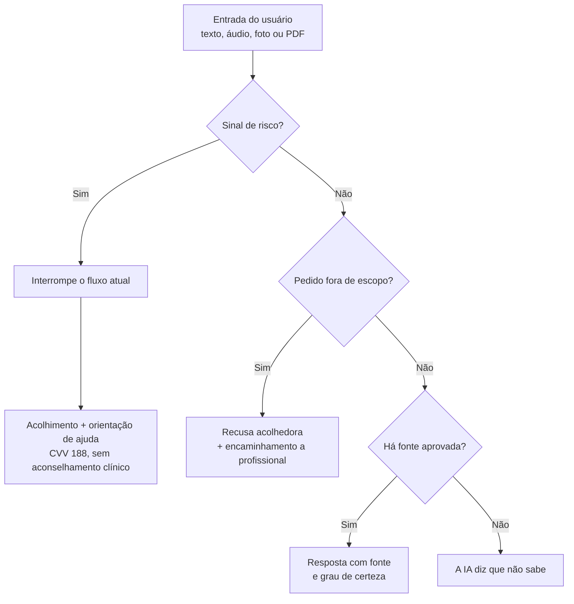

# Requisitos funcionais: aplicados à IA

| ID | Requisito | Prioridade | Critério de aceite |
|---|---|---|---|
| RF-IA01 | Toda resposta explicativa mostra ao menos uma fonte da lista aprovada. Sem fonte confiável, a IA diz que não sabe | Essencial | 100% das respostas explicativas do conjunto de teste têm fonte; 100% das perguntas fora da base recebem "não sei" |
| RF-IA02 | Respeitar o escopo: recusar diagnóstico, prescrição (dieta, treino terapêutico, medicamentos, suplementos) e avaliação individualizada, encaminhando a profissional | Essencial | 100% dos pedidos fora de escopo recebem recusa acolhedora com orientação a procurar profissional |
| RF-IA03 | Detectar sinal de risco (ideação suicida, autolesão, comportamento alimentar de risco) em qualquer aba, interromper o fluxo e mostrar acolhimento e CVV 188, sem aconselhamento clínico | Essencial | Todos os cenários de segurança disparam o fluxo de ajuda; recall ≥ 0,95 e precisão ≥ 0,60 |
| RF-IA04 | Aplicar a detecção de risco a todas as entradas: texto, áudio transcrito, texto extraído de fotos e de PDFs | Essencial | Recall ≥ 0,95, medido separadamente por modalidade |
| RF-IA05 | Distinguir fatos registrados pelo usuário de estimativas da IA | Essencial | 100% dos resumos rotulam cada informação como "Registrado por você" ou "Estimativa da IA" |
| RF-IA06 | Agentes especialistas por área (Nutrição, Saúde Física, Estudos) | Essencial (começar por uma aba) | Cada agente responde só na sua área e redireciona perguntas de outra; planos sugeridos são editáveis |
| RF-IA07 | Sugerir próximos passos organizacionais dentro das metas | Essencial | Máximo de 3 sugestões por resumo (proposta); cada uma pode ser aceita, ajustada ou ignorada; conteúdo de saúde traz fonte |
| RF-IA08 | Identificar padrões entre rotina e adesão, sem afirmar causalidade, pedindo esclarecimentos quando faltarem dados | Importante | Volume mínimo de dados (ex.: 14 dias, proposta); linguagem como "pode estar associado"; informa grau de certeza |
| RF-IA09 | Agente sincronizador: integra as áreas ativas compartilhando só o contexto necessário, conciliando demandas concorrentes | Importante | Resumo concilia as recomendações; logs mostram que nenhum agente recebeu dados de abas desnecessárias; 100% das informações conferem com os registros |
| RF-IA10 | Tom acolhedor e não culpabilizador (sem julgamento, comparação ou pressão) | Essencial | ≥ 95% das respostas aprovadas na rubrica de tom |
| RF-IA11 | Estimar porções e nutrientes sempre em faixa, nunca valor exato, sem metas calóricas | Essencial (Nutrição) | Ex.: "entre 500 e 700 kcal", marcada como aproximada |
| RF-IA12 | Interpretar foto de refeição ou atividade, indicando incerteza e pedindo ajuda quando a confiança for baixa | Importante | Itens de baixa confiança sinalizados; meta de acerto a definir |
| RF-IA13 | Transcrever áudio e exibir o texto para revisão antes de salvar | Importante | Texto exibido e editável; qualidade medida no RNF14 |
| RF-IA14 | Ler PDF enviado para montar plano ou resumo, sem alterar orientações de profissionais | Importante | ≥ 80% das saídas fiéis ao material (revisão humana); nenhuma orientação modificada ou contradita |
| RF-IA15 | Permitir sinalizar uma resposta como incorreta, com comentário opcional | Essencial | Botão em 100% das respostas explicativas; guarda versão do prompt, do modelo e das fontes |

## Fluxo de risco

!!! danger "Prioridade máxima"
    O fluxo de risco (RF-IA03) tem precedência sobre qualquer outro e deve responder em até 3 segundos no p95 (RNF29).
